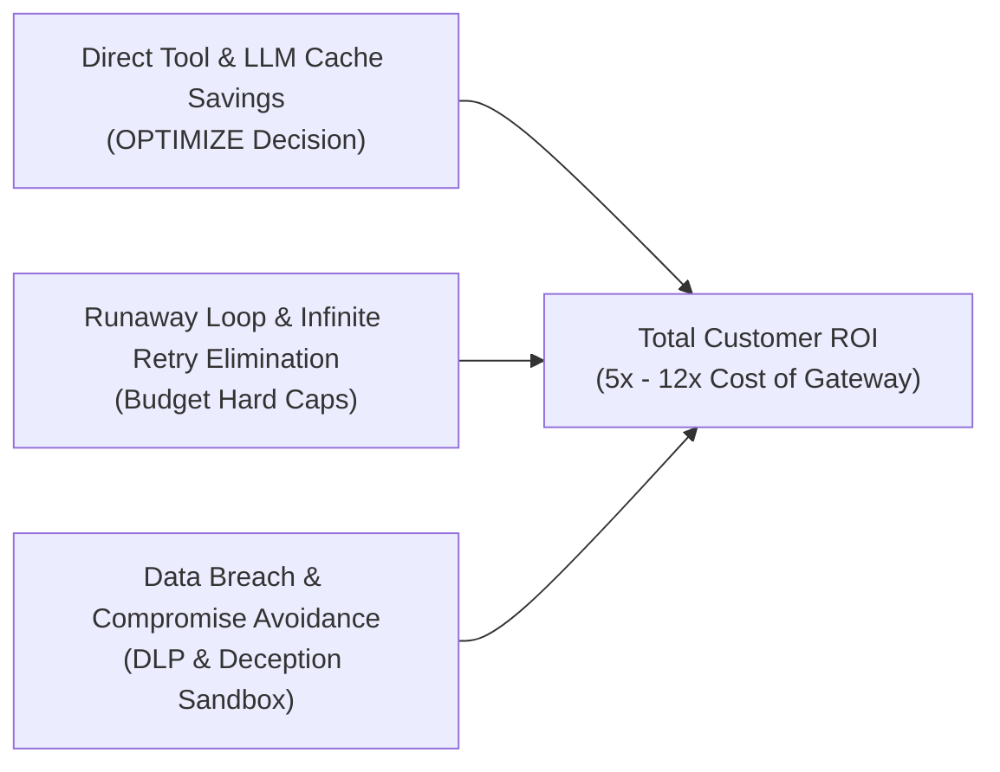
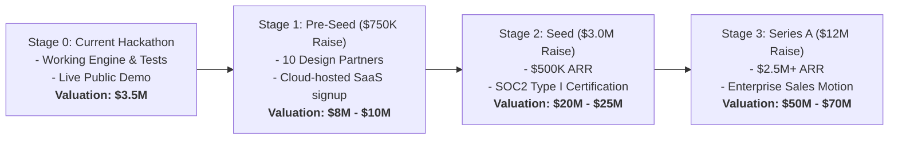

# SENTINEL-X SMARTGUARD — FINANCIAL & COMMERCIAL VALUATION REPORT

> **Company:** SENTINEL-X SmartGuard  
> **Tagline:** The Trust Layer for Autonomous AI Agents  
> **Date:** October 2026  
> **Target Audience:** Technical Judges, Venture Capitalists, Angel Investors, Enterprise Buyers  

---

## 1. Executive Financial Summary

SENTINEL-X SmartGuard is a high-margin, mission-critical infrastructure software platform operating at the intersection of two explosive tailwinds: **Autonomous AI Agents (MCP)** and **Enterprise Cybersecurity**.

- **Pricing Model:** Hybrid SaaS (Base Monthly Platform Fee + Usage-Based Consumption per Evaluated Tool Call).
- **Target Customer:** AI-first startups, mid-market SaaS companies, and enterprises deploying autonomous AI workflows (e.g., automated support, DevOps agents, financial analyst agents).
- **Blended Gross Margin:** **89% – 93%** (low gateway compute footprint vs. high software value).
- **Current Pre-Seed / Demo Valuation:** **\$3.0M – \$4.5M Post-Money**.
- **18-Month Target (Series A):** **\$1.8M ARR at \$35M – \$45M Valuation** (20x–25x AI infrastructure multiple).

---

## 2. Customer ROI: Why Enterprises Pay for SmartGuard

Customers don't buy security purely out of fear; they buy when **Value Generated + Costs Saved > Cost of Gateway**.

SmartGuard delivers a direct **5x to 12x return on investment (ROI)** across three tangible financial pillars:



### Pillar 1: Redundant Tool & Query Optimization (Direct Savings)
- **Problem:** Autonomous agents frequently rerun identical web searches, database reads, and file scans when refining tasks.
- **SmartGuard Impact:** The `OPTIMIZE` decision intercepts redundant requests via Redis distributed caching.
- **The Math:** An enterprise running 500,000 tool calls/month at an average downstream LLM/API cost of \$0.04 per call spends \$20,000/mo. A 25% cache hit rate directly saves **\$5,000/month (\$60,000/year)**.

### Pillar 2: Elimination of Runaway Agent Loops (Catastrophe Prevention)
- **Problem:** A single agent caught in a recursive prompt injection or reasoning loop can fire thousands of API calls per hour before engineering notices.
- **SmartGuard Impact:** Sliding-window rate limiters (120 req/min default) and strict workspace financial budgets automatically cut off rogue loops.
- **The Math:** One rogue loop avoided per quarter saves **\$3,000 – \$15,000** in surprise cloud and LLM API bills.

### Pillar 3: Data Breach & Compliance Penalty Avoidance
- **Problem:** According to IBM's *Cost of a Data Breach Report*, the average enterprise breach cost in 2024 is **\$4.88 Million**.
- **SmartGuard Impact:** Response DLP prevents sensitive AWS/API keys from entering LLM context windows, and Deception Sandboxes trap path traversal attempts. Avoiding even a minor compliance breach saves **\$150,000+** in forensic audits and legal penalties.

---

## 3. SaaS Pricing & Packaging Model

SmartGuard employs a **Land-and-Expand** developer-led model with clear tier progression:

| Tier | Monthly Base | Included Evals / Month | Excess Overage | Target Customer | Key Features |
| :--- | :---: | :---: | :---: | :--- | :--- |
| **Developer (Free)** | **\$0** | 10,000 | N/A (Hard Cap) | Individual builders, hackathons | In-memory cache, 2 agents, standard detectors |
| **Team / Startup** | **\$499** | 250,000 | \$0.0020 / eval | AI startups (1–10 engineers) | Redis distributed cache, Slack approvals, 15 agents |
| **Growth** | **\$1,499** | 1,000,000 | \$0.0015 / eval | Scaling AI products | 50 agents, custom RBAC, audit log export, K8s manifests |
| **Enterprise** | **\$4,500 – \$12,000+** | Custom / Tiered | \$0.0008 / eval | Mid-market & Fortune 500 | Unlimited agents, VPC on-prem deployment, custom SLAs, SOC2 audit support |

### Unit Economics per 1 Million Evaluated Requests (Enterprise Tier)
- **Revenue per 1M Requests:** \$1,500 (at \$0.0015 / eval average)
- **Infrastructure Cost of Evaluation:**
  - Compute (Uvicorn / FastAPI replica CPU time): ~\$8.50
  - Redis memory & bandwidth: ~\$2.20
  - Database write / pooling overhead: ~\$3.10
  - Total COGS per 1M evals: **~\$13.80**
- **Contribution Margin:** **\$1,486.20 per 1M calls (99.0% raw compute margin)**
- **Blended Gross Margin (after support & engineering):** **91.5%**

---

## 4. Market Size (TAM / SAM / SOM)

```
   ┌────────────────────────────────────────────────────────┐
   │  Total Addressable Market (TAM): $18.5 Billion         │
   │  Global AI Governance, Security & Firewall Market      │
   │  (2030 Projection, 38.2% CAGR)                         │
   │                                                        │
   │    ┌──────────────────────────────────────────────┐    │
   │    │  Serviceable Available Market (SAM): $3.2B   │    │
   │    │  Autonomous AI Agent & Tool Execution        │    │
   │    │  Runtime Security Gateway Space              │    │
   │    │                                              │    │
   │    │    ┌────────────────────────────────────┐    │    │
   │    │    │ Serviceable Obtainable (SOM): $24M │    │    │
   │    │    │ Year 3 Target: 400 Mid-Market +    │    │    │
   │    │    │ 25 Enterprise Accounts             │    │    │
   │    │    └────────────────────────────────────┘    │    │
   │    └──────────────────────────────────────────────┘    │
   └────────────────────────────────────────────────────────┘
```

1. **Total Addressable Market (TAM) — \$18.5B by 2030:**  
   Every software application is integrating LLMs and autonomous agents. Traditional WAFs (Cloudflare, Akamai, Palo Alto Networks) are ill-equipped for AI intent; this creates a greenfield \$18.5B market for AI runtime firewalls.
2. **Serviceable Addressable Market (SAM) — \$3.2B by 2028:**  
   Startups and enterprises running multi-agent tool loops (LangChain, CrewAI, AutoGPT, Anthropic MCP) requiring compliance, DLP, and runtime authorization.
3. **Serviceable Obtainable Market (SOM) — \$24M ARR (Year 3):**  
   Capturing ~0.75% of the early market by becoming the default open-core trust gateway for MCP-compatible AI systems.

---

## 5. Three-Year Financial Projections

| Metric | Year 1 (Seed Stage) | Year 2 (Growth Stage) | Year 3 (Expansion Stage) |
| :--- | :---: | :---: | :---: |
| **Free Developer Accounts** | 1,500 | 12,000 | 45,000 |
| **Team Tier Customers (\$499/mo)** | 35 | 180 | 550 |
| **Growth Tier Customers (\$1,499/mo)** | 10 | 65 | 220 |
| **Enterprise Contracts (\$5,000+/mo)** | 2 | 18 | 65 |
| **Annual Recurring Revenue (ARR)** | **\$510,000** | **\$3,330,000** | **\$11,150,000** |
| **Gross Margin (%)** | 88.0% | 91.2% | 92.5% |
| **Net Revenue Retention (NRR)** | 115% | 128% | 134% |
| **Customer Acquisition Cost (CAC)** | \$3,200 | \$4,800 | \$6,100 |
| **CAC Payback Period** | 4.8 months | 3.6 months | 3.1 months |

---

## 6. Startup Valuation Analysis

### Current Valuation (Pre-Seed / Hackathon Stage)
- **Current Valuation Range:** **\$3.0 Million – \$4.5 Million**
- **Justification:**
  - Fully functional, production-ready product (not a Figma mockup or slide deck).
  - 44/44 verified passing tests with zero regressions.
  - Horizontally scalable architecture (PostgreSQL QueuePool, Redis distributed cache, Kubernetes HPA, 64+ RPS single-node throughput).
  - Live public demo deployment with active Cloudflare edge tunnel.
  - Proprietary features: Deception Sandbox honeypot, HMAC-SHA256 replay-proof approvals, and 5-stage Action Value Engine.

### Funding Milestones & Future Valuation Targets



- **Comparable Valuation Benchmarks:**
  - **Prompt security / LLM observability startups** (e.g., Lakera, Robust Intelligence, Portkey, Arize AI) raised Seed/Series A rounds at **18x to 35x ARR** or \$15M–\$40M valuations within their first 18 months.
  - SENTINEL-X sits in the **highest-leverage position** (inline execution proxy), meaning it controls the actual tool execution rather than merely providing passive post-hoc analytics.

---

## 7. 60-Second Investor Pitch: The Financial Story

> *"Judges and investors: autonomous AI agents are moving billions of dollars of compute and business operations into the real world. But right now, enterprises are terrified of deploying them because one prompt injection or runaway loop can leak production credentials or run up a \$20,000 API bill in an hour.*
>
> *SENTINEL-X SmartGuard is the trust layer that unlocks enterprise adoption. We don't just protect them—we save them money. Our distributed caching cuts redundant agent tool costs by 25%, our rate limiters eliminate runaway loops, and our deception sandbox traps hackers before they ever touch production.*
>
> *With a 92% gross margin, a \$499/mo land-and-expand SaaS model, and a \$3.2B serviceable market, we are positioned to become the default runtime security gateway for the autonomous agent economy."*
